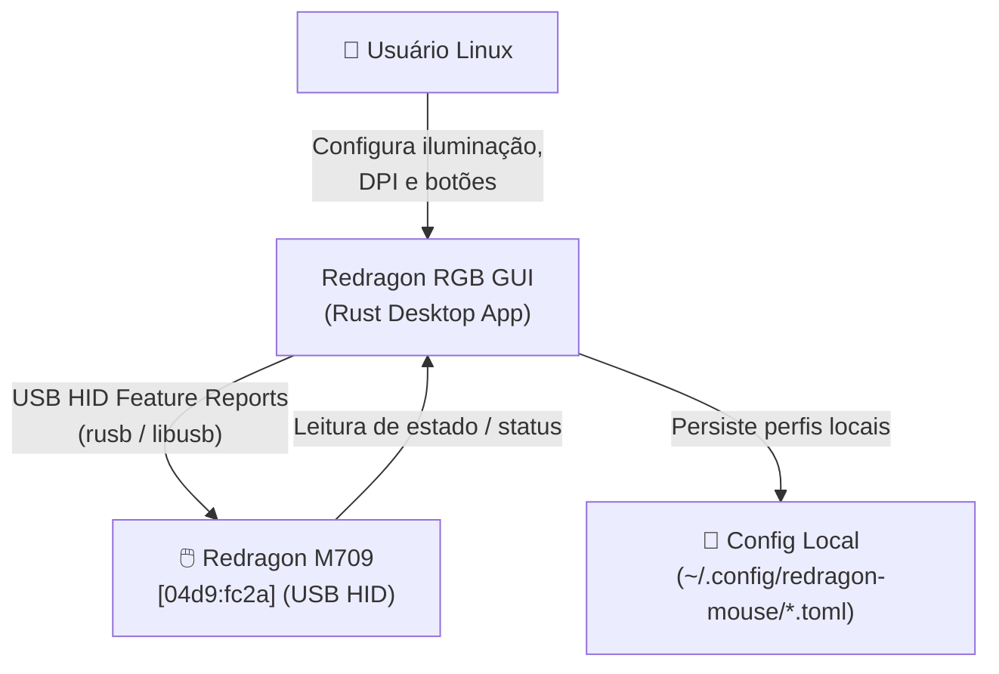
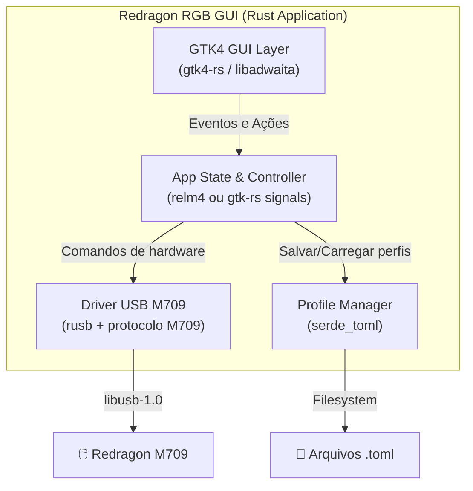
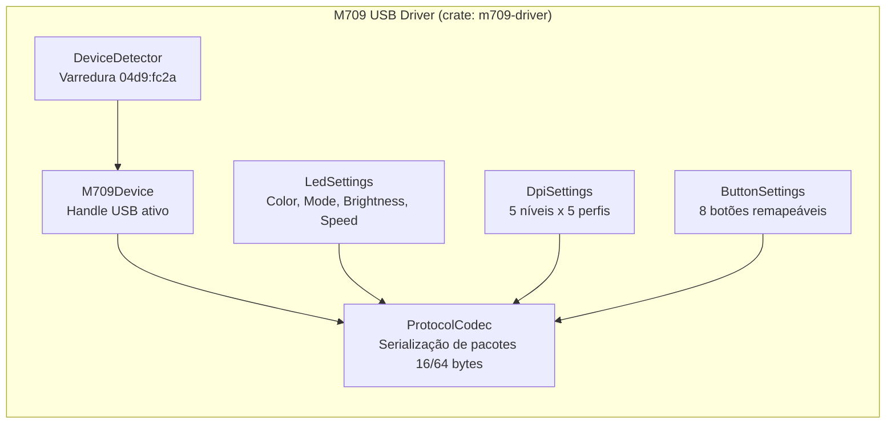

# Critérios — Discovery 01: Redragon RGB GUI (M709)

## Restrições técnicas

1. **Plataforma:** Linux x86_64 / arm64 com suporte a GTK4 e libusb-1.0.
2. **Permissões USB:** Requer udev rules instaladas (`/etc/udev/rules.d/mouse_m908.rules` já instaladas pelo usuário).
3. **Dispositivo:** Redragon M709 com Vendor ID `0x04D9` e Product ID `0xFC2A`.
4. **Dependências nativas:** `libusb-1.0-dev`, `libgtk-4-dev` e toolchain Rust (`cargo`, `rustc`).

## Critérios de aceitação (executáveis)

### CA-01: Detecção do Redragon M709
```bash
# O CLI / Driver detecta e confirma conexão com o dispositivo
cargo run --bin redragon-mouse -- detect
# Output esperado: "Found Redragon M709 [04d9:fc2a] on Bus XXX Device YYY"
```

### CA-02: Leitura do estado atual do mouse
```bash
# O driver lê as configurações salvas no hardware (perfil ativo, cor, modo, DPI)
cargo run --bin redragon-mouse -- dump
```

### CA-03: Alteração de LED (Cor, Modo, Brilho, Velocidade)
```
Dado que o Redragon M709 está conectado
Quando o usuário seleciona uma cor no ColorPicker (ex: #FF0055) e o modo "breathing" na GUI
E clica em "Aplicar"
Então os pacotes USB HID correspondentes são enviados
E a iluminação física do mouse altera imediatamente
```

### CA-04: Seleção e gravação de perfil (1 a 5)
```
Dado que o usuário altera os parâmetros de iluminação e DPI do Perfil 2
Quando clica em "Salvar Perfil"
Então os dados são gravados na memória interna do mouse M709
E persistem mesmo após desconectar e reconectar o USB
```

### CA-05: Ajuste de níveis de DPI
```
Dado que o mouse possui 5 níveis de DPI configuráveis
Quando o usuário ajusta os sliders de DPI (ex: 800, 1600, 2400, 3200, 5000)
E aplica
Então a troca de DPI no botão físico reflete as novas velocidades
```

### CA-06: Mapeamento dos 8 botões físicos
```
Dado os 8 botões físicos do M709:
- Esquerdo, Direito, Médio, Avançar, Voltar, DPI, Scroll Up, Scroll Down
Quando o usuário altera a função de um botão na GUI e aplica
Então a função remapeada é executada pelo mouse
```

## Diagramas C4

### Context (Nível 1)



### Container (Nível 2)



### Component (Nível 3) — Driver USB M709


